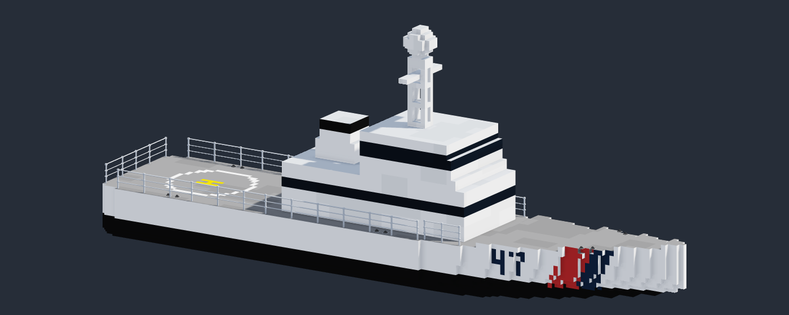
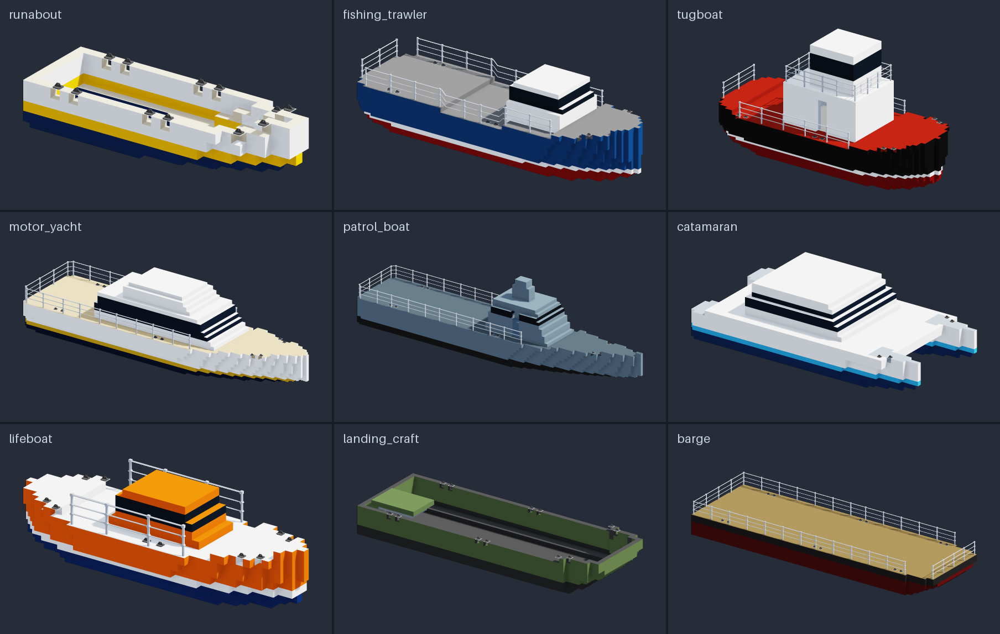
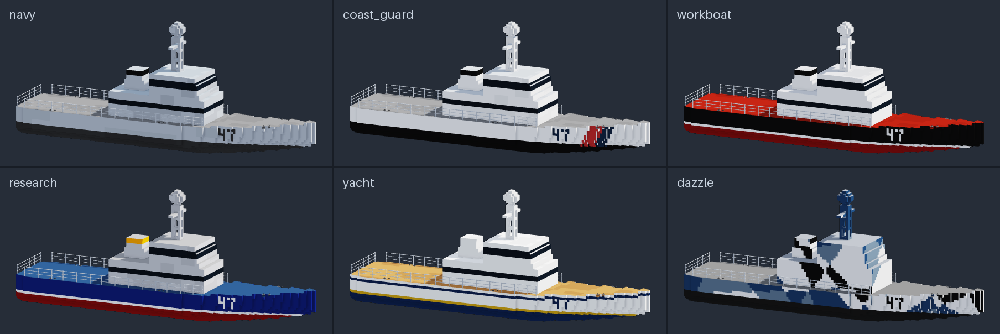
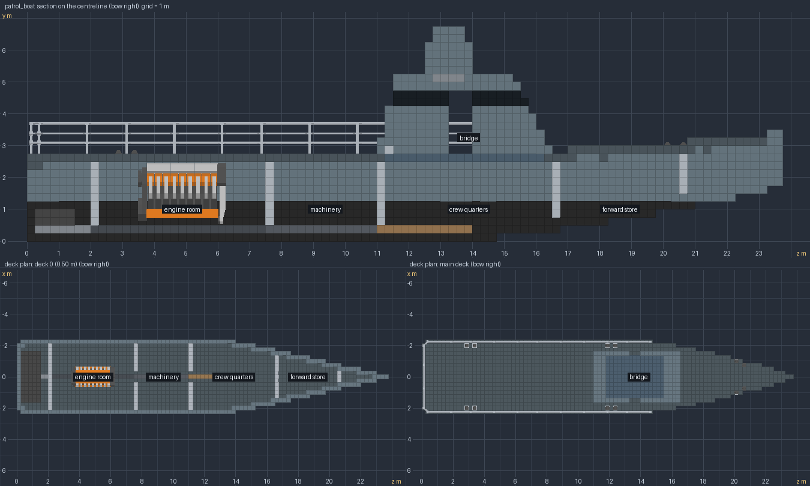
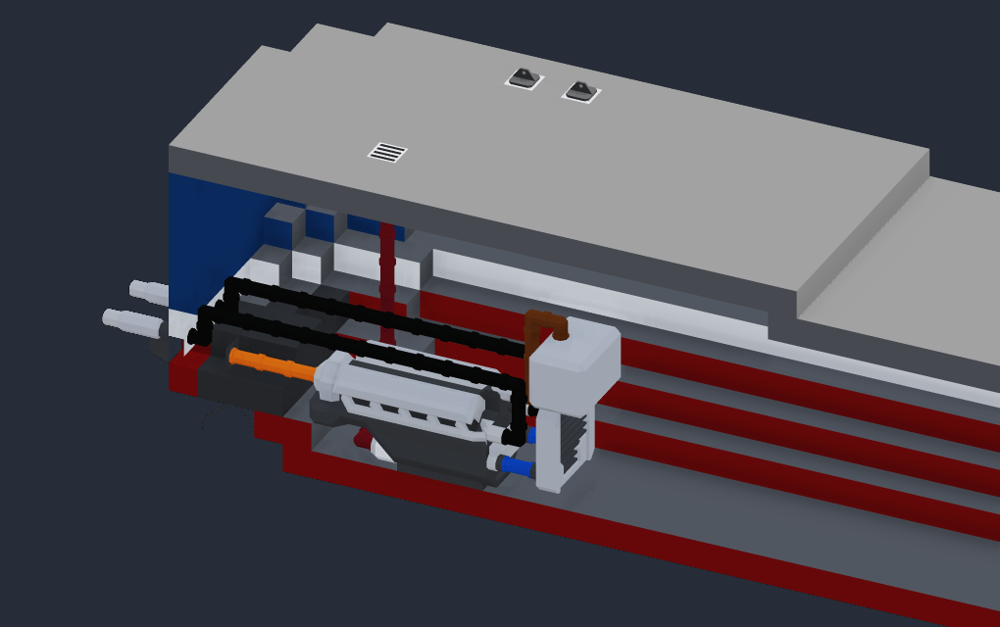
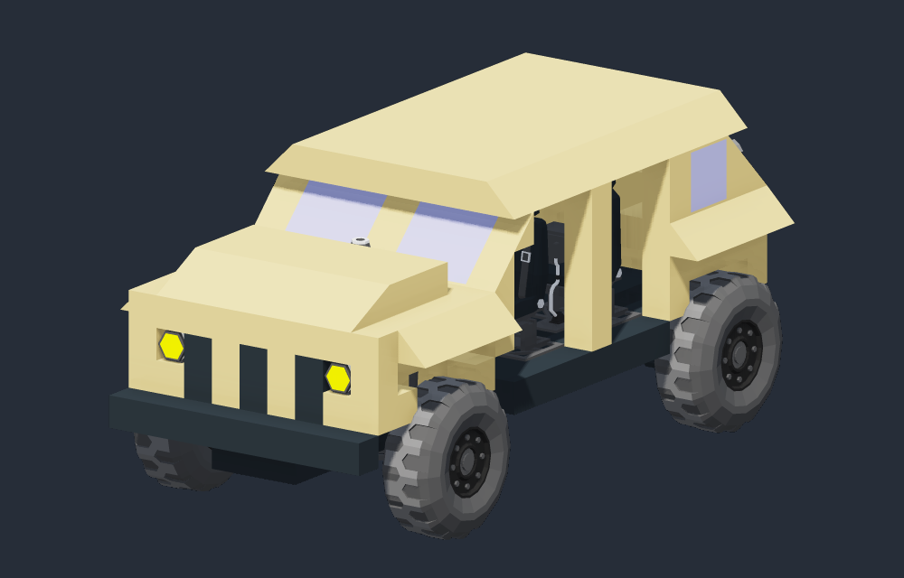
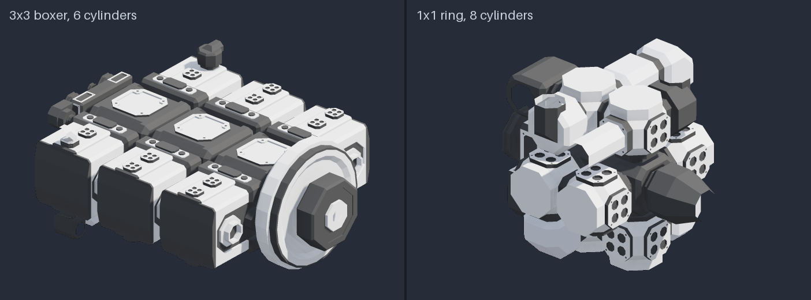
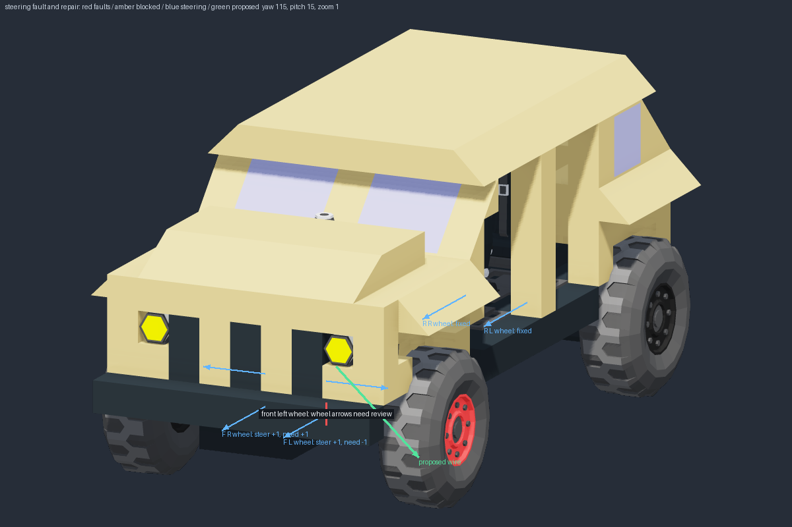
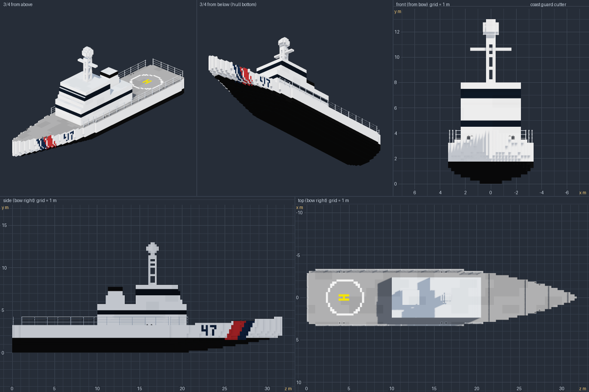

# Stormworks MCP

Describe a vehicle to your AI assistant and get a file you can load at a workbench in
[Stormworks: Build and Rescue](https://store.steampowered.com/app/573090/).

Stormworks MCP is a local [MCP](https://modelcontextprotocol.io) server for Claude Desktop, the
ChatGPT / Codex Windows app and other MCP clients. It gives the assistant tools to shape boat
hulls, lay out rooms and engine rooms, place any part installed in your game, wire and plumb
them, and find faults. The assistant looks at a render after every change, fixes what is off,
and saves the result to your Stormworks vehicles folder.

Everything runs on your PC. Part definitions are read from your own game install, and game files
are never changed.

**[Download for Windows](https://github.com/macery12/Stormworks-MCP/releases/latest)** ·
[Install guide](docs/install.md) · [Building walkthrough](docs/building.md) ·
[What is verified in game](docs/in-game-testing.md)

## How it works

1. **Describe it.** "A 30 m coast guard cutter with a helideck aft", "a four-seat 4x4", "a
   six-cylinder boxer engine". Rough ideas are fine; the assistant asks about size and which
   workbench you build at.
2. **The assistant builds and checks it.** It works in stages, renders each one, compares the
   picture with your request and fixes what is wrong. You see the previews too.
3. **Load it in game.** The vehicle is saved with a Load-menu thumbnail. Open a workbench, press
   **Load** and pick it.

Every image on this page is a render of something the server built.

## What you can build

### Boats and ships

Start from a hull archetype (runabout, rowboat, fishing trawler, tugboat, motor yacht, landing
craft, lifeboat, patrol boat, catamaran, barge) or describe a hull from scratch: length, beam,
depth, bow shape, rake, flare, deadrise, sheer, bulbous bow, skegs, and one to three hulls.
Superstructure is built from boxes, cylinders, domes, spheres and lattice masts that can be
stacked, mirrored, repeated, raked and rotated.

Railings, mooring points and ballast are added the way experienced builders place them, and
every build reports its estimated waterline, trim and stability. Set a workbench size and the
summary tells you whether the design fits; enter a real ship's dimensions with a scale such as
`1:4`, or let it scale the design to fill your workbench.

Hulls are plain blocks by default. Optional smoothing skins them with the game's wedge and
pyramid pieces; it is still being refined, so check the preview before you save
([hull smoothing](docs/hull-smoothing.md)).

### Paint and liveries

Paint is per face, like a hand-built ship. Pick a named livery (navy, coast guard, workboat,
research, yacht, dazzle or splinter camouflage) or design your own with hull numbers, bow
flashes, stripes, hazard markings, panels, deck markings and camouflage.

### Interiors and engine rooms

Add decks, bulkheads and rooms. The assistant gets a centreline section and a labelled plan of
every level, with each room's size, headroom and doors. Doors and hatch-and-ladder assemblies
are real game parts, fitted only where the whole part fits; a request that cannot fit leaves the
wall sealed instead of cutting a hole.

The powertrain stage puts a diesel engine low in the hull with its radiator and fuel tank,
routes the pipes, and sets the propeller and rudder into the transom. Air comes in through a
deck port and the exhaust leaves through the transom. Exposed pipes are colour-coded by what
they carry.

### Cars, aircraft and anything else

Boats are one starting point. The assistant can also start from an empty draft, a land preset
(a bare chassis, a buggy or a connected four-seat 4x4) or a copy of one of your own vehicles,
and place any part installed in your game. Saved vehicles, or a box cut out of one, can be
reused inside another as a prefab. Hinged and pivoting sections are separate bodies that can
each be shown and edited.

Modular engines of any size are assembled from the game's own coupled parts: in-line, boxer or
compact ring layouts with manifolds, starters, alternators, flywheel and clutch, and a list of
every connection point to pipe and wire.

### Wiring, fault finding and repair

The assistant connects signal and electric wires between part ports, routes pipes (exposed or
inside blocks), and applies ready-made control set-ups for engine start, clutch, brakes and
lights. A preflight check follows fuel, air, exhaust, cooling, the driveline, electric power and
controls, and a repair plan turns each fault into a fix you can preview before it is applied.
Other checks trace each compartment for leaks and estimate mass, flotation, thrust and lift.

Before you test, the assistant can export a separate copy with an in-game checklist tied to that
exact file. See [diagnose, repair and verify](docs/vehicle-repair.md).

### Checking its own work

Every change comes back as a picture: a 3/4 view from above and below plus front, side and top
views with metre rulers. The assistant can also point a camera at any detail, hide the bodywork
to look at the parts inside, or open the vehicle in an interactive 3D viewer in your browser.
Edits go in batches that can be previewed first and undone afterwards.

## Install

You need Windows 10 or 11, Stormworks installed through Steam, and an MCP client on the same PC.

1. Download the installer (`-setup.exe`) from the
   [latest release](https://github.com/macery12/Stormworks-MCP/releases/latest) and run it. It
   can add itself to Claude Desktop and the ChatGPT / Codex app for you.
2. Open **Stormworks MCP** from the Start menu and press **Start server**.
3. Restart your AI client. Keep the Stormworks MCP window open while you build.

The [install guide](docs/install.md) covers the portable version, running from source, setting
up other clients by hand, upgrading, troubleshooting and configuration.

## Your first boat

1. Start a new chat and ask:

   > Design me a chunky fishing boat for a small workbench. Show me a preview, then save it.

2. Look at the previews as they come in and ask for changes: "taller wheelhouse", "make it
   navy grey", "add an engine room".
3. In Stormworks, open a workbench, press **Load** and pick the name the assistant gave it.

Then check it against the [in-game checklist](docs/in-game-testing.md#checking-a-boat). The
[building walkthrough](docs/building.md) covers stages, units and exact edits.

## Example prompts

**Boats**

- "Give me three different 10 m rescue boat hulls and show them side by side."
- "Take the tugboat preset but make it longer and sleeker, like a pilot boat."
- "Add an engine room aft, crew quarters amidships and a bridge, then show me the deck plans."
- "Build a 1:4 scale model of a 110 m destroyer that fits my workbench."
- "Paint it in the coast guard livery with hull number 47."

**Other vehicles and parts**

- "Build the 4x4 preset, then show me the equipment with the bodywork hidden."
- "Make a six-cylinder 3x3 boxer engine with a flywheel and two alternators."
- "Turn the engine bay of my 'Old Trawler' into a prefab and drop it into this new hull."
- "Estimate how my plane's lift compares to its weight."

**Checking and fixing**

- "Run preflight on my 4x4 and preview the repairs before applying any."
- "Check whether the engine room is watertight."
- "Export a test copy and give me the in-game checklist."
- "Import my 'Old Trawler' into a draft, repaint the bridge and save it as a new vehicle."

## Good to know

- **The game is the only real test.** The server writes files without running Stormworks.
  [In-game testing](docs/in-game-testing.md) tracks which features have been checked in game;
  load what you build and tell the assistant what you see.
- **Nothing is simulated.** Preflight checks that the right parts are present and connected;
  physics numbers are estimates. Driving, flying and floating are decided in game.
- **Your vehicles are safe.** Saving never overwrites a vehicle the server did not create.
  Imported vehicles are copied into a draft, and the original file is left alone.
- **Very large ships** are fine to design, but the game spawns at most 131,072 parts. The build
  summary shows the part count against that limit.
- **The 3D viewer** loads three.js from a CDN, so it needs an internet connection.

## Documentation

| Guide | Read it to |
| --- | --- |
| [Install and set up](docs/install.md) | Install, connect a client, troubleshoot and configure. |
| [Building walkthrough](docs/building.md) | Make a first build, keep units straight, edit exactly and diagnose a result. |
| [Building any vehicle](docs/start.md) | Build from an empty draft: parts, connections, modular engines, prefabs, bodies and physics. |
| [Staged builder](docs/staged-builder.md) | Build a boat in stages: components, access, propulsion, engine rooms, seals and tanks. |
| [Land vehicles](docs/land-vehicles.md) | Use the land presets, the chassis spec, parts, connections and preflight. |
| [Diagnose, repair and verify](docs/vehicle-repair.md) | Repair faults, apply control set-ups and record in-game tests. |
| [Hull smoothing](docs/hull-smoothing.md) | Choose slope pieces and check hull depth. |
| [In-game testing](docs/in-game-testing.md) | Check a vehicle in game and see what is verified. |
| [Vehicle file format](docs/vehicle-format.md) | Read or write Stormworks vehicle XML from your own tools. |
| [Releases](docs/releases.md) | Verify a download or build the Windows app yourself. |
| [Development](docs/development.md) | Run the tests, regenerate these images and find your way around the code. |

## Contributing

Issues and pull requests are welcome. Changes must pass `uv run pytest` and
`uv run ruff check .`; changes to geometry also need a rendered review and an in-game check.
See [development](docs/development.md).

## License

[MIT](LICENSE). This is an unofficial fan project, not affiliated with or endorsed by Geometa, the
developer of Stormworks. It modifies no game files and ships no game assets; part definitions are
read from your own install at runtime.
